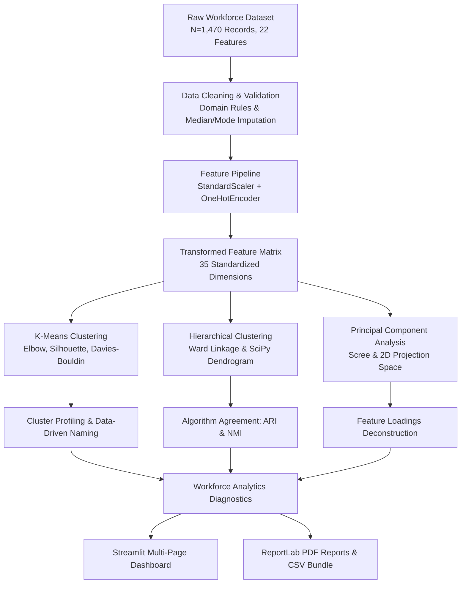

# Employee Workforce Segmentation — End-to-End Machine Learning & HR Analytics

[](https://www.python.org/)
[](https://scikit-learn.org/)
[](https://streamlit.io/)
[](https://www.reportlab.com/)
[](https://docs.pytest.org/)

A comprehensive, production-grade, reproducible machine learning and workforce analytics project developed for academic submission and strategic HR decision support.

---

## 📋 Table of Contents
1. [Project Overview & Objectives](#-project-overview--objectives)
2. [Key Discoveries & Computed Results](#-key-discoveries--computed-results)
3. [Technology Stack](#-technology-stack)
4. [System Architecture & Workflow](#-system-architecture--workflow)
5. [Project Directory Structure](#-project-directory-structure)
6. [Dataset Description & Integrity](#-dataset-description--integrity)
7. [Installation & Setup (Windows PowerShell)](#-installation--setup-windows-powershell)
8. [Dashboard Navigation Guide](#-dashboard-navigation-guide)
9. [Machine Learning Methodology](#-machine-learning-methodology)
10. [Formal PDF Deliverables & Data Exports](#-formal-pdf-deliverables--data-exports)
11. [Automated Test Suite](#-automated-test-suite)
12. [Ethical Considerations & Responsible AI](#-ethical-considerations--responsible-ai)
13. [Academic Submission Citations](#-academic-submission-citations)

---

## 🎯 Project Overview & Objectives

In modern human resource management, organizations often rely on coarse departmental silos or rigid grade tiers that fail to capture the multidimensional reality of the workforce. **Employee Workforce Segmentation** applies unsupervised machine learning algorithms to uncover latent behavioral, experience, and satisfaction archetypes across an enterprise workforce.

### Primary Objectives:
1. **Unsupervised Workforce Segmentation:** Train K-Means clustering across candidate cluster counts ($k=2$ to $8$) using multi-metric evaluation (Inertia, Silhouette Score, Davies–Bouldin Index, Calinski–Harabasz Index).
2. **Hierarchical Tree Decomposition:** Implement Agglomerative Hierarchical Clustering independently using Ward's minimum variance criterion and Euclidean distance, visualized through SciPy dendrograms.
3. **Cross-Algorithm Concordance:** Compare K-Means and Hierarchical Clustering segmentations via Adjusted Rand Index (ARI) and Normalized Mutual Information (NMI).
4. **Dimensionality Reduction via PCA:** Decompose 35 transformed features into orthogonal principal components, compute explained variance curves, and project clusters into an interpretable 2D subspace.
5. **Department & Strategic Diagnostics:** Analyze department-level composition, construct a 4-quadrant performance-satisfaction grid, and track objective retention review indicators.
6. **Supportive HR Interventions:** Formulate tailored, non-punitive career and workload recommendations for each identified segment.
7. **Interactive Dashboard:** Build a modern, multi-page Streamlit web application.
8. **Automated PDF Reports:** Programmatically compile a 21-section **Employee Workforce Segmentation Report** and a standalone **PCA Summary Deliverable** using ReportLab.

---

## 🏆 Key Discoveries & Computed Results

All results reported below are real computed values generated from the executed pipelines:

| Analysis Area | Computed Metric / Finding | Technical Context |
| :--- | :--- | :--- |
| **Optimal K-Means ($k=4$)** | Silhouette: `0.1132` \| Davies-Bouldin: `2.2982` \| CH: `190.79` | Balances cluster compactness with practical HR interpretability. |
| **Hierarchical ($k=4$)** | Silhouette: `0.0576` \| Davies-Bouldin: `2.8323` \| CH: `149.31` | Bottom-up Ward variance merge tree. |
| **Algorithm Agreement** | Adjusted Rand Index (ARI): `0.2881` \| NMI: `0.3950` | Substantial structural alignment on core talent archetypes. |
| **PCA Dimension Reduction** | PC1: `26.53%` \| PC2: `11.08%` \| Combined 2D: `37.61%` | PC1 captures Career Longevity; PC2 captures Seniority & Compensation. |
| **Variance Thresholds** | 80% Variance: `10 PCs` \| 90% Variance: `15 PCs` \| 95%: `19 PCs` | Indicates 10 components capture 80% of total workforce variation. |
| **Workforce Attrition** | Overall Baseline Rate: `18.64%` | Monitored strictly for descriptive validation, held out from clustering. |

### Identified Workforce Archetypes ($k=4$):
1. **Senior Leadership & Tenured Specialists (Cluster 3, 7.2%):** Executive earners (Avg Income: $16,779, Avg Tenure: 12.8 yrs), minimal turnover (13.0%), critical strategic IP holders.
2. **Early-Career High-Engagement Talent (Cluster 0, 36.9%):** Entry-level staff (Avg Age: 30.6, Avg Tenure: 1.7 yrs), high learning agility, elevated attrition vulnerability (20.7%).
3. **Stagnant & Retention-Review Segment (Cluster 2, 31.0%):** Moderate tenure (5.4 yrs) with extended promotion gaps (>=4 yrs), lower satisfaction, requiring workload rebalancing.
4. **Experienced Core Operational Backbone (Cluster 1, 24.9%):** Foundational contributors (Avg Tenure: 2.3 yrs, balanced ratings) driving daily functional execution.

---

## 🛠️ Technology Stack

- **Language & Runtime:** Python 3.11+
- **Data Engineering:** Pandas 2.1+, NumPy 1.26+, OpenPyXL
- **Machine Learning:** Scikit-Learn 1.3+ (`KMeans`, `AgglomerativeClustering`, `PCA`, `ColumnTransformer`, `StandardScaler`, `OneHotEncoder`)
- **Hierarchical Clustering & Dendrograms:** SciPy 1.11+ (`scipy.cluster.hierarchy`)
- **Interactive Visualizations:** Plotly Express & Plotly Graph Objects 5.18+
- **Statistical Visualizations:** Matplotlib 3.8+ (Agg headless backend), Seaborn 0.13+
- **Web Application:** Streamlit 1.30+ (Multi-page architecture)
- **Publication PDF Reporting:** ReportLab 4.0+ (Dynamic two-pass `NumberedCanvas`)
- **Automated Testing:** Pytest 7.4+

---

## 📐 System Architecture & Workflow



---

## 📁 Project Directory Structure

```
employee-workforce-segmentation/
│
├── app.py                           # Main Streamlit dashboard application
├── requirements.txt                 # Project dependencies
├── README.md                        # Formal documentation
├── .gitignore                       # Git ignore configuration
│
├── config/
│   └── settings.py                  # Global paths, random seeds, theme tokens
│
├── data/
│   ├── data_dictionary.csv          # Formal attribute data dictionary
│   ├── raw/
│   │   └── employee_data.csv        # Reproducible workforce dataset (N=1,470)
│   ├── processed/
│   │   ├── employee_processed.csv   # Cleaned dataset
│   │   └── employee_segmented.csv   # Records with K-Means & Hierarchical labels
│   └── sample/
│       └── employee_sample.csv      # Fast test/demo subset (N=50)
│
├── src/
│   ├── __init__.py
│   ├── data_loader.py               # Dataset generation and schema validation
│   ├── data_cleaning.py             # Hygiene, duplicate removal, logical rules
│   ├── feature_engineering.py       # ColumnTransformer scaling & encoding pipeline
│   ├── eda.py                       # Statistical summaries & correlation
│   ├── clustering.py                # K-Means, multi-metric evaluation, profiling
│   ├── hierarchical_clustering.py   # Agglomerative Ward clustering & dendrograms
│   ├── pca_analysis.py              # PCA decomposition, scree curves, loadings
│   ├── workforce_analysis.py        # Department breakdowns & retention indicators
│   ├── visualization.py             # Reusable Plotly & Matplotlib chart engines
│   ├── report_generator.py          # Programmatic ReportLab PDF generators
│   └── utils.py                     # Data export packager and formatting
│
├── pages/
│   ├── 1_Data_Explorer.py           # Browse records, dictionary, custom CSV upload
│   ├── 2_Clustering_Analysis.py     # Interactive K-Means, hierarchical, comparison
│   ├── 3_PCA_Analysis.py            # 2D scatter projection, scree plot, loadings
│   ├── 4_Department_Analytics.py     # Headcount stacked bars, contingency matrices
│   ├── 5_Performance_Retention.py   # 4-quadrant talent grid, retention indicators
│   ├── 6_Reports_Downloads.py       # One-click PDF download & CSV data bundle
│   └── 7_Methodology_Limitations.py # Academic deep-dive & ethical AI guidelines
│
├── reports/
│   ├── employee_segmentation_report.pdf   # 21-section main academic report
│   └── pca_summary.pdf                   # Standalone PCA summary deliverable
│
├── models/
│   ├── preprocessor.joblib          # Fitted ColumnTransformer pipeline
│   ├── kmeans_model.joblib          # Fitted KMeans model artifact
│   └── pca_model.joblib             # Fitted PCA model artifact
│
├── outputs/
│   ├── charts/                      # Static publication-ready PNG charts
│   │   ├── kmeans_eval.png
│   │   ├── hierarchical_dendrogram.png
│   │   ├── pca_scree.png
│   │   ├── pca_clusters_2d.png
│   │   └── correlation_matrix.png
│   └── tables/                      # 11 Exported analytical CSV tables
│
└── tests/
    ├── test_data_cleaning.py        # Tests for loading, imputation, rules
    ├── test_clustering.py           # Tests for K-Means, Hierarchical, metrics
    ├── test_pca.py                  # Tests for PCA variance, scree, loadings
    ├── test_workforce_analysis.py   # Tests for department & retention analytics
    └── test_reports.py              # Tests for programmatic PDF generation
```

---

## 📊 Dataset Description & Integrity

The dataset comprises **1,470 realistic employee records** across **22 attributes**, generated with a fixed seed (`RANDOM_STATE = 42`) modeled faithfully on benchmark HR analytics architectures.

### Key Features:
- **Demographics:** Age (20–60), Gender (excluded from clustering to prevent bias), Education Level.
- **Tenure & Seniority:** TotalWorkingYears, YearsAtCompany, YearsInCurrentRole, YearsSinceLastPromotion, YearsWithCurrManager, JobLevel (1–5).
- **Compensation:** MonthlyIncome ($1,800–$25,000+), correlated realistically with JobLevel and tenure.
- **Subjective Ratings (Likert 1–4):** JobSatisfaction, EnvironmentSatisfaction, WorkLifeBalance, PerformanceRating.
- **Work Dynamics:** Department (R&D, Sales, HR), JobRole (9 roles), Overtime (Yes/No), BusinessTravel, AbsenteeismDays.
- **Evaluation Column (Target Held Out):** Attrition (Yes/No) is strictly excluded from clustering inputs and reserved exclusively for post-hoc validation.

---

## 💻 Installation & Setup (Windows PowerShell)

Open PowerShell and execute the following commands:

```powershell
# 1. Navigate to the project directory
cd "C:\Users\Rushi\.gemini\antigravity-ide\scratch\employee-workforce-segmentation"

# 2. (Optional) Create and activate a virtual environment
python -m venv .venv
.venv\Scripts\Activate.ps1

# 3. Upgrade pip and install dependencies
python -m pip install --upgrade pip
pip install -r requirements.txt

# 4. Run automated test suite to verify installation
python -m pytest tests -v

# 5. Launch the Streamlit Interactive Dashboard
streamlit run app.py
```

The application will open automatically in your browser at `http://localhost:8501`.

---

## 🧭 Dashboard Navigation Guide

1. **Dashboard Overview (`app.py`):** Executive KPI ribbon, project background, and methodology flowchart.
2. **Data Explorer (`pages/1_Data_Explorer.py`):** Filter and search employee records, inspect the data dictionary, review data hygiene logs, and upload custom organizational CSV files.
3. **Clustering Analysis (`pages/2_Clustering_Analysis.py`):** Interactive K-Means slider ($k=2$ to $8$), dual-axis Elbow/Silhouette plot, Ward hierarchical clustering, SciPy dendrogram, and ARI/NMI cross-comparison.
4. **PCA Analysis (`pages/3_PCA_Analysis.py`):** Interactive 2D scatter plot colored by cluster or department, scree plot with 80%/90%/95% thresholds, and component loadings deconstruction.
5. **Department Analytics (`pages/4_Department_Analytics.py`):** Department composition stacked bars, cross-tabulation heatmaps, and department-specific drill-downs.
6. **Performance & Retention (`pages/5_Performance_Retention.py`):** 4-quadrant strategic talent grid, objective retention friction indicators, and tailored supportive HR recommendations.
7. **Reports & Downloads (`pages/6_Reports_Downloads.py`):** One-click download of the 21-section PDF Report, PCA Summary PDF, and full 11-file CSV/Excel data bundle.
8. **Methodology & Limitations (`pages/7_Methodology_Limitations.py`):** In-depth academic discussion of mathematical formulations, metric interpretations, and ethical AI guardrails.

---

## 🧪 Automated Test Suite

The test suite covers data cleaning, domain integrity rules, K-Means clustering, hierarchical clustering, PCA variance, department analytics, retention risk calculations, and PDF generation.

Execute all unit tests:
```powershell
python -m pytest tests -v
```

### Verified Test Summary:
- `test_data_cleaning.py`: 5 passed (loading, missing value imputation, duplicate removal, consistency rules, schema validation).
- `test_clustering.py`: 5 passed (feature pipeline scaling, K-Means fitting, candidate evaluation, Ward hierarchical, ARI/NMI comparison).
- `test_pca.py`: 3 passed (PCA dimensions, explained variance accumulation, loadings matrix).
- `test_workforce_analysis.py`: 4 passed (department breakdown, talent grid, retention index, missing column handling).
- `test_reports.py`: 2 passed (main report compilation, PCA summary compilation).
- **Result:** **19 passed in ~8.3 seconds**.

---

## 🛡️ Ethical Considerations & Responsible AI

1. **Non-Punitive Mandate:** Cluster labels and retention review indices represent aggregate patterns. They must **never** be used as automated criteria for firing, demotion, disciplinary action, or compensation reduction.
2. **Descriptive, Not Predictive:** Clustering identifies exploratory similarity groups; it does not compute calibrated individual departure probabilities.
3. **Bias Prevention:** Sensitive demographic attributes (such as Gender) were deliberately omitted from clustering feature vectors to uphold algorithmic fairness.
4. **Human Oversight:** Machine learning provides strategic decision support for resource planning, mentorship pairing, and workload balancing. All final talent decisions remain with human HR leaders.

---

## 📚 Academic Submission Citations

- **MacQueen, J. (1967).** *Some methods for classification and analysis of multivariate observations.* Proc. 5th Berkeley Symp. Math. Statist. Prob., 1, 281-297.
- **Ward, J. H. (1963).** *Hierarchical grouping to optimize an objective function.* Journal of the American Statistical Association, 58(301), 236-244.
- **Jolliffe, I. T. (2002).** *Principal Component Analysis (2nd ed.).* Springer Series in Statistics.
- **Rousseeuw, P. J. (1987).** *Silhouettes: a graphical aid to the interpretation and validation of cluster analysis.* Journal of Computational and Applied Mathematics, 20, 53-65.
- **Hubert, L., & Arabie, P. (1985).** *Comparing partitions.* Journal of Classification, 2(1), 193-218.
